  

  
  
  
  
  
  
  

# 🛡️ Awesome Governance, Risk, and Compliance (GRC)

> **The definitive curated directory of enterprise SaaS platforms and production-ready open-source projects for Governance, Risk, and Compliance (GRC), Integrated Risk Management (IRM), and automated continuous auditing.**

A comprehensive, keyword-rich reference for Chief Information Security Officers (CISOs), risk managers, compliance officers, internal auditors, and SecOps teams navigating modern compliance frameworks—including **ISO/IEC 27001:2022**, **SOC 2 Type II**, **NIST CSF 2.0**, **NIST SP 800-53**, **PCI-DSS v4.0.1**, **HIPAA**, **GDPR**, **EU DORA**, **EU NIS2**, and the **EU AI Act**.

---

## 📑 Table of Contents

- [📊 Sector Overview & Market Dynamics](#-sector-overview--market-dynamics)
- [💼 SaaS & Enterprise GRC Platforms](#-saas--enterprise-grc-platforms)
- [🔓 Open-Source GRC & Compliance Tools](#-open-source-grc--compliance-tools)
- [🏛️ Regulatory Frameworks Reference](#️-regulatory-frameworks-reference)
- [🤝 How to Contribute](#-how-to-contribute)
- [📈 Star History](#-star-history)
- [☕ Support & Sponsorship](#-support--sponsorship)
- [⚠️ Disclaimer](#️-disclaimer)

---

## 📊 Sector Overview & Market Dynamics

* **Estimated Market Size**: The global **Governance, Risk, and Compliance (GRC) software market** was valued at approximately **$54.6 billion in 2024** and is projected to reach **$134.8 billion by 2030**, growing at a compound annual growth rate (**CAGR**) of **15.8%**. Rapid expansion is catalyzed by tightening global data privacy legislation, strict digital operational resilience mandates (e.g., EU DORA and NIS2), corporate ESG regulations, and mandatory AI safety governance standards (ISO/IEC 42001 and the EU AI Act).
* **Market Fragmentation & Competitive Dynamics**: The sector is **moderately fragmented**. High-end enterprise modernization is led by multi-billion dollar platform conglomerates (such as ServiceNow, OneTrust, Diligent, and Archer) serving large-scale Fortune 500 transformations. However, it is **not a winner-take-all market**: agile cloud-native platforms (e.g., AuditBoard, Workiva, LogicGate) dominate specialized operational domains like SOX reporting, internal audit, and AI risk, while an active open-source ecosystem provides self-hosted sovereign solutions without predatory seat licensing.

---

## 💼 SaaS & Enterprise GRC Platforms

The table below lists the category-leading enterprise GRC and IRM SaaS platforms, **sorted in descending order by company size (valuation / market capitalization)**.

| 🏢 Platform / Vendor | 📈 Company Size & Valuation | 💵 Starting Tier Pricing | ⏳ Free Tier / Trial Limit | 🎯 Core Focus & Capabilities |
| :--- | :--- | :--- | :--- | :--- |
| **[ServiceNow IRM / GRC](https://www.servicenow.com/)** | **~$155B Market Cap** *(~$13.3B FY24 Revenue, NYSE: NOW)* | **$50,000 / year** *(Baseline enterprise platform entry; approx. $125–$200/fulfiller user/month)* | **No free tier**; 15-day Personal Developer Instance (PDI) with full administrative low-code API access (resets on inactivity); custom sales-guided POC for enterprise buyers | Enterprise Integrated Risk Management (IRM) unified with CMDB, automated continuous control monitoring, vendor risk management, business-context risk scoring, and regulatory change tracking across Fortune 500 fleets. |
| **[Workiva](https://www.workiva.com/)** | **~$4.6B Market Cap** *(~$966M TTM Revenue, NYSE: WK)* | **$60,000 / year** *(Baseline annual commitment across core reporting and compliance workspaces)* | **No free tier**; 30-day sales-provisioned guided sandbox POC with pre-loaded mock reporting templates and audit workpapers | SEC financial reporting, SOX 404 compliance, internal controls over financial reporting (ICFR), ESG disclosure automation, and audit-trail data traceability connecting directly to ERP ledgers. |
| **[OneTrust](https://www.onetrust.com/)** | **~$4.5B–$5.3B Valuation** *(>$500M ARR; Series D backed by Sands Capital & Generation)* | **$10,000 / year** *(Platform minimum entry tier; core modules start at $833/month)* | **No free tier**; 14-day sales-provisioned POC trial with full module access; standalone free cookie banner template generator permanently available for basic websites | Market leader in data privacy automation, consent management, Third-Party Risk Management (TPRM), continuous IT risk assessments against 100+ global frameworks, and AI governance for EU AI Act compliance. |
| **[Diligent HighBond](https://www.diligent.com/)** | **~$4.0B+ Valuation** *(~$600M+ Annual Revenue; Insight Partners & Blackstone)* | **$5,000 / year** *(Starter tier for Diligent One platform; median enterprise GRC spend is $23,000–$45,000/year)* | **No free tier**; 30-day evaluation trial for ACL Analytics engine; 30-day admin-guided GovernAI trial upon sales qualification | Board governance, enterprise risk management, automated internal audit workflows, SOX testing, fraud detection analytics, and executive board reporting consoles. |
| **[AuditBoard](https://www.auditboard.com/)** | **~$3.0B+ Valuation** *(Acquired by Hg in May 2024; >$200M ARR)* | **$25,000 / year** *(Entry package for mid-market organizations; approx. $2,083/month)* | **No free tier**; 14-to-30-day structured interactive POC sandbox pre-configured with sample audit and SOX workpapers upon sales qualification | Purpose-built internal audit management (OpsAudit), SOX compliance automation (SOXhub), enterprise risk management (RiskOversight), and vendor risk tracking trusted by over 50% of the Fortune 500. |
| **[Archer IRM](https://www.archerirm.com/)** | **~$2.0B+ Valuation** *(Acquired by Cinven; ~$220M Annual Revenue)* | **$30,000 / year** *(Starting tier for mid-market cloud deployments; approx. $2,500/month)* | **No free tier**; 30-day guided enterprise pilot POC with pre-configured risk registers and Archer Exchange app-packs upon sales approval | Institutional enterprise risk management, quantitative risk analysis (Open FAIR dollar-value loss exposure), third-party risk governance, and regulatory change tracking for global Tier-1 banks and defense contractors. |
| **[Riskonnect](https://www.riskonnect.com/)** | **~$1.2B+ Valuation** *(Backed by Thoma Bravo & TA Associates; ~$250M ARR)* | **$20,000 / year** *(Starting rate for standalone modular tools; full enterprise IRM/RMIS suites start at $283,000/year)* | **No free tier**; 90-day targeted evaluation trial for select AI risk-writing modules; custom 30-day guided sandbox upon scoping consultation | Comprehensive Risk Management Information System (RMIS) and enterprise GRC built on Salesforce architecture; integrates claims management, enterprise risk, compliance, and Business Continuity Management (BCM). |
| **[MetricStream](https://www.metricstream.com/)** | **~$478M Valuation** *(Backed by Clearlake Capital & Goldman Sachs; ~$260M ARR)* | **$75,000 / year** *(Entry enterprise deployment; approx. $6,250/month excluding implementation)* | **No free tier**; 30-day custom enterprise POC with guided scoping and sample risk ontology upon sales qualification | AI-driven GRC platform recognized across all Chartis GRC categories; features MetricStream CyberGRC, continuous cyber-risk quantification, autonomous evidence gathering, and AI-powered regulatory compliance copilot. |
| **[LogicGate Risk Cloud](https://www.logicgate.ai/)** | **~$300M+ Valuation** *($166M venture funding raised; ~$50M ARR)* | **$13,000 / year** *(Starting tier for single-application mid-market deployment; approx. $1,083/month)* | **No free tier**; 14-day sandbox trial with up to 5 power user licenses and pre-built Risk Cloud workflow templates upon sales demo | No-code agile GRC platform with customizable Risk Cloud workflows, automated control testing with reasoning logs, TPRM, and Model Context Protocol (MCP) server connectivity for natural-language agentic queries. |
| **[SAI360](https://www.sai360.com/)** | **~$250M+ Valuation** *(Acquired by Symphony Technology Group; ~$140M ARR)* | **$24,000 / year** *(Starting tier for baseline compliance or ethics module; approx. $2,000/month)* | **No free tier**; 30-day structured proof-of-concept environment with pre-loaded audit templates upon sales qualification | Integrated GRC and Environment, Health, Safety & Sustainability (EHS&S) platform; pairs operational risk management and internal controls with ethics, regulatory change management, and automated compliance training libraries. |

---

## 🔓 Open-Source GRC & Compliance Tools

Below are active open-source repositories for Governance, Risk, and Compliance, continuous security auditing, policy-as-code, and compliance automation.

> **Sorted in descending order by GitHub_Stars.** Each repository includes a real-time Stars_Badge linking directly to its GitHub stargazers.

### 1. 🛡️ [Wazuh](https://github.com/wazuh/wazuh) 
* **License**: GPL-2.0  
* **Focus**: Unified XDR, SIEM & Regulatory Compliance Monitoring  
* **Description**: Enterprise-ready security monitoring platform that automatically audits systems against regulatory compliance benchmarks—including **PCI-DSS v4.0**, **HIPAA**, **GDPR**, **NIST SP 800-53**, and **TSC SOC 2**. Features automated file integrity monitoring (FIM), vulnerability detection, configuration assessment, and continuous compliance auditing across on-prem, multi-cloud, and containerized infrastructure.

### 2. 🔍 [Lynis](https://github.com/CISOfy/lynis) 
* **License**: GPL-3.0  
* **Focus**: Automated Security Auditing & Compliance Verification  
* **Description**: Battle-tested, battle-proven security auditing tool for Linux, macOS, and UNIX operating systems. Lynis conducts deep host-level compliance inspections against **ISO 27001**, **PCI DSS**, **HIPAA**, and **CIS Benchmarks**, delivering actionable remediation tips, hardening indexes, and modular compliance scan reports without requiring heavy agents.

### 3. ☁️ [Prowler](https://github.com/prowler-cloud/prowler) 
* **License**: Apache-2.0  
* **Focus**: Multi-Cloud Security Assessment & Continuous Compliance  
* **Description**: The industry-standard open-source cloud security scanner for AWS, Azure, Google Cloud Platform (GCP), and Kubernetes. Prowler automates security assessments and compliance audits against **30+ regulatory frameworks**—including CIS Benchmarks, NIST 800-53, ISO/IEC 27001, SOC 2, PCI-DSS, GDPR, HIPAA, and FFIEC—generating audit-ready JSON, CSV, and HTML compliance artifacts.

### 4. 📜 [Open Policy Agent (OPA)](https://github.com/open-policy-agent/opa) 
* **License**: Apache-2.0  
* **Focus**: Policy-as-Code & Unified Governance Enforcement  
* **Description**: CNCF graduated general-purpose policy engine providing expressive declarative policy language (Rego). Enables organizations to codify governance, risk guardrails, and compliance requirements across microservices, Kubernetes admission controllers, API gateways, and CI/CD deployment pipelines to guarantee continuous compliance.

### 5. 🪲 [DefectDojo](https://github.com/DefectDojo/django-DefectDojo) 
* **License**: BSD-3-Clause  
* **Focus**: Vulnerability Management, Risk Remediation & Security Verification  
* **Description**: OWASP flagship application vulnerability correlation and security orchestration tool. Aggregates findings from 150+ security scanners, deduplicates vulnerabilities, tracks remediation SLAs, maps risks to regulatory compliance standards, and generates executive risk-posture reports.

### 6. 📋 [CISO Assistant](https://github.com/intuitem/ciso-assistant-community) 
* **License**: AGPL-3.0  
* **Focus**: All-in-One Enterprise GRC & Framework Mapping Platform  
* **Description**: The most comprehensive community-driven open-source GRC suite. Native support for **220+ international security frameworks and 45+ mapping sets** with automatic control crosswalks (covering ISO 27001:2022, NIST CSF, SOC 2, PCI DSS, NIS2, DORA, GDPR, and CMMC). Features an integrated risk register (ISO 27005 & EBIOS RM), Third-Party Risk Management (TPRM), Business Impact Analysis (BIA), REST API, Model Context Protocol (MCP) agent support, and built-in AI compliance copilot.

### 7. 💻 [ComplianceAsCode](https://github.com/ComplianceAsCode/content) 
* **License**: BSD-3-Clause  
* **Focus**: Security Content Automation Protocol (SCAP) & Baseline Enforcement  
* **Description**: SCAP Security Guide project providing automated compliance baselines, remediation playbooks (Ansible, Bash), and OpenSCAP automated auditing policies for enterprise Linux distributions and cloud workloads against DISA STIG, USGCB, PCI-DSS, and CIS baselines.

### 8. 📝 [Comply](https://github.com/strongdm/comply) 
* **License**: Apache-2.0  
* **Focus**: SOC 2 Compliance Automation & Policy Management  
* **Description**: Command-line SOC 2 compliance automation framework written in Go. Automates policy document authoring with Markdown, tracks procedure checklists, tickets evidence collection in GitHub/Jira, and builds audit-ready compliance packages for third-party auditors.

### 9. 🤖 [Probo](https://github.com/getprobo/probo) 
* **License**: ISC  
* **Focus**: AI-Native GRC Platform with 270+ MCP Automation Tools  
* **Description**: Modern, developer-first GRC suite for engineering and security teams pursuing SOC 2, ISO 27001, and GDPR. Includes inherent and residual risk matrices, control libraries, vendor risk management (TPRM), data protection impact assessments (DPIA), access review workflows, a dedicated `prb` CLI with 44+ command groups, GraphQL API, and **270+ MCP tools** enabling autonomous AI agent workflows.

### 10. ⚡ [GovReady-Q](https://github.com/GovReady/govready-q) 
* **License**: GPL-3.0  
* **Focus**: DevSecOps Self-Service Assessment & ATO Automation  
* **Description**: Open-source, self-service GRC platform designed to automate System Security Plans (SSPs) and fast-track Authority to Operate (ATO) assessments for NIST SP 800-53 and FedRAMP compliance in DevSecOps environments.

### 11. 🏢 [Unicis Platform CE](https://github.com/UnicisTech/unicis-platform-ce) 
* **License**: Apache-2.0  
* **Focus**: Transparent GRC & Compliance Alternative to Vanta/Drata  
* **Description**: All-in-one privacy and compliance automation platform for startups and SMEs. Delivers automated evidence collection, risk register tracking, policy management, and compliance workflows for **ISO 27001**, **SOC 2**, **GDPR**, and **NIST** with self-hosted and air-gapped deployment support.

### 12. 📊 [SimpleRisk](https://github.com/simplerisk/code) 
* **License**: AGPL-3.0  
* **Focus**: Straightforward Enterprise Risk Assessment & Mitigation Tracking  
* **Description**: Popular open-source risk management solution engineered for simplicity. Provides centralized risk registers, risk scoring (Classic, CVSS, DREAD), risk mitigation workflows, audit tracking, and security control mapping. Docker-ready and easy to stand up in minutes.

### 13. 📦 [Eramba](https://github.com/eramba/docker) 
* **License**: Eramba Community / Custom Open  
* **Focus**: Mature Enterprise GRC, Internal Controls & Policy Management  
* **Description**: Long-running enterprise GRC software offering a free Community edition with no user or asset count restrictions. Covers risk management, policy life-cycle reviews, internal controls testing, security incident logging, vendor risk assessments, and compliance mapping for ISO 27001 and PCI DSS.

### 14. 🧭 [Cairn](https://github.com/frousselet/cairn) 
* **License**: GNU AGPL-3.0  
* **Focus**: Lightweight Self-Hosted GRC Aligned with ISO 27005 & EBIOS RM  
* **Description**: Self-hosted GRC application with asset valuation (CIA triad), quantitative risk management based on **ISO 27005** and French **ANSSI EBIOS RM**, statutory incident clocks (GDPR 72-hour notifications, NIS2, DORA), and public Trust Center capabilities. Operates a built-in MCP server and supports local LLM execution via Ollama.

---

## 🏛️ Regulatory Frameworks Reference

Modern GRC platforms orchestrate compliance against major global and industry-specific regulations:

| Framework / Regulation | Scope / Governing Body | Primary Focus Area | Key GRC Requirements |
| :--- | :--- | :--- | :--- |
| **ISO/IEC 27001:2022** | International (ISO/IEC) | Information Security Management System (ISMS) | 93 Annex A controls, risk assessment & treatment (ISO 27005), internal audit, management review |
| **SOC 2 Type II** | AICPA (United States) | Trust Services Criteria (TSC) | Security, Availability, Processing Integrity, Confidentiality, Privacy over a 3-12 month review period |
| **NIST CSF 2.0** | NIST (United States / Global) | Cybersecurity Risk Management | Govern, Identify, Protect, Detect, Respond, Recover functions with continuous supply chain oversight |
| **PCI-DSS v4.0.1** | PCI SSC (Global Payment Card) | Payment Card Data Security | 12 technical requirements, continuous control testing, quarterly vulnerability scans, tamper protection |
| **HIPAA Security Rule** | HHS OCR (United States) | Protected Health Information (ePHI) | Administrative, physical, and technical safeguards, Business Associate Agreements (BAAs), breach notification |
| **EU GDPR** | European Union | Personal Data Privacy & Protection | Lawfulness of processing, DPIA/TIA assessments, 72-hour breach notification clock, data subject rights |
| **EU DORA** | European Union (ESA) | Digital Operational Resilience in Finance | ICT risk management, third-party ICT service provider oversight, mandatory digital threat testing (TLPT) |
| **EU NIS2** | European Union (ENISA) | Critical & Essential Infrastructure Security | Incident handling, supply chain risk management, cyber hygiene policies, severe corporate penalties |
| **EU AI Act & ISO 42001** | European Union / ISO | Artificial Intelligence Risk Governance | Risk classification (high/prohibited), data governance, bias mitigation, transparency, and logging |

---

## 🤝 How to Contribute

We actively welcome contributions from the global risk, privacy, and compliance community! 🚀

1. **Fork the Repository** on GitHub.
2. **Create a Feature Branch** (`git checkout -b feature/add-new-grc-platform`).
3. **Add or Update Entries**:
   - Ensure SaaS entries include verified company valuation/revenue, starting tier pricing, and explicit free tier / trial terms.
   - For open-source projects, include the repository URL, official license, and social Stars_Badge.
   - Place entries in proper sorted order.
4. **Follow Markdown Conventions**: Keep descriptions objective, factual, and backed by citations.
5. **Submit a Pull Request** with a concise summary of additions or updates.

---

## 📈 Star History

---

## ☕ Support & Sponsorship

Thank you for visiting and using **Awesome Governance, Risk, and Compliance (GRC)**! 🛡️

If this curated directory has saved you time, simplified your compliance evaluations, or helped streamline your enterprise risk architecture:

- ⭐ **Star this repository** to improve visibility for the security & compliance community.
- 🍴 **Fork it** to maintain your organization's custom internal GRC knowledge base.
- 📢 **Share it** with peers, CISOs, auditors, and engineering colleagues.
- 💖 **Sponsor or buy a coffee** via the [GitHub Sponsor Dashboard](https://github.com/sponsors/ishandutta2007) to support ongoing curation, automation, and maintenance.

---

## ⚠️ Disclaimer

* This repository is an independent, **community-curated index** created solely for informational, research, and educational purposes. It does not constitute formal legal, accounting, compliance, or information security advisory services.
* Software pricing, enterprise valuations, and free tier parameters are based on publicly disclosed filings, official vendor announcements, and reputable SaaS market intelligence. Vendors reserve the right to alter pricing tiers, packaging, and commercial terms without notice.
* Organizations implementing open-source GRC software are responsible for verifying code integrity, software supply chain security, and regulatory suitability for their specific regulatory jurisdiction (e.g., SOX 404, HIPAA, DORA, NIS2).
* All product names, logos, and brands are property of their respective trademark owners.

---

  <b>Built with care for Chief Information Security Officers, Risk Managers, Compliance Officers, and Security Architects worldwide.</b> 
  Continuous Compliance • Evidence-Based Governance • Sovereign Risk Architecture

